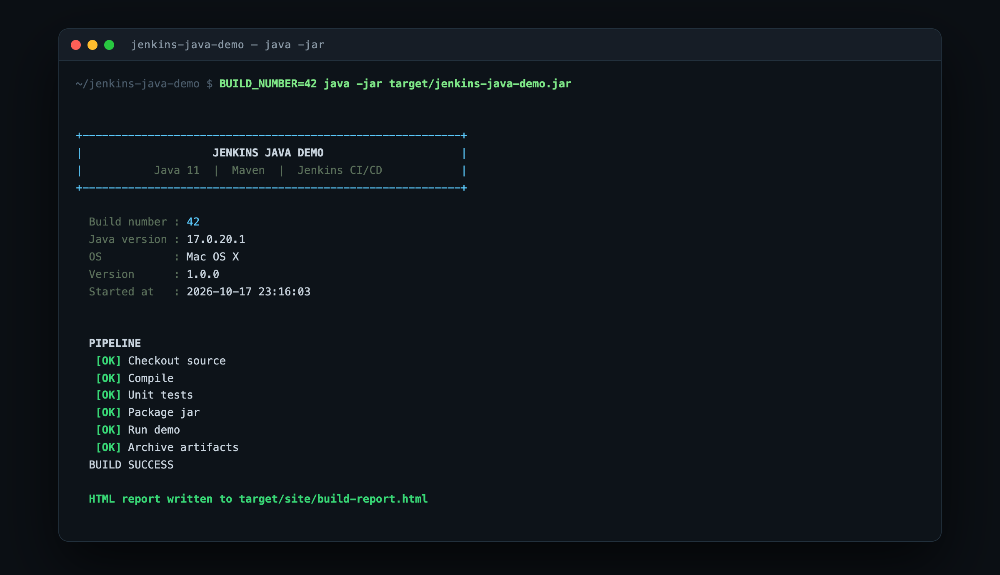
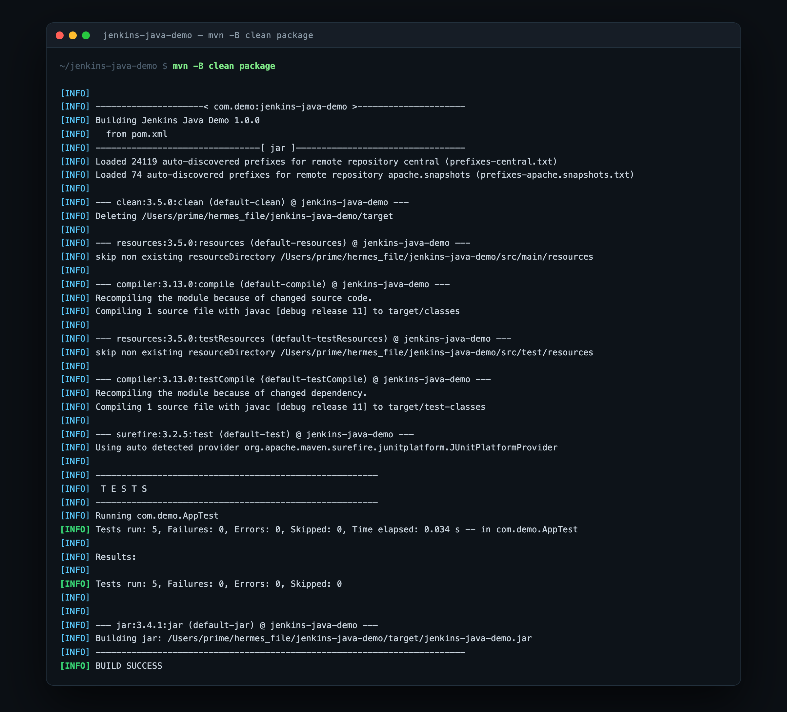
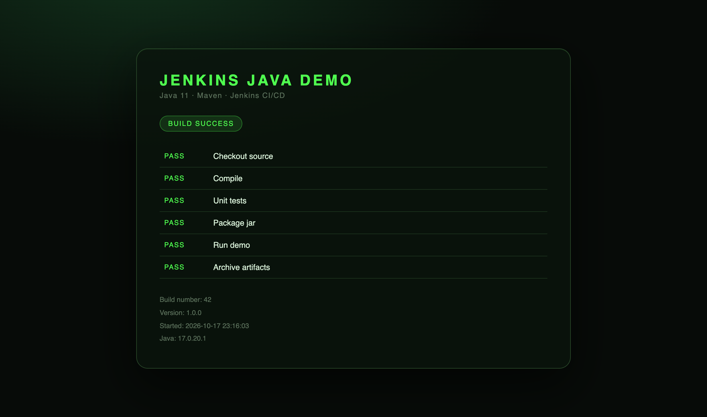

# Jenkins Java Demo

Your first Jenkins pipeline, working end to end.
One Java class, five tests, six stages — nothing to install except Java and Maven.



---

## What this gives you

- A **real Java application** that builds, tests, packages and runs
- A **Jenkinsfile** with six small stages you can read in one sitting
- **Five unit tests** whose results Jenkins publishes automatically
- A **dark-themed HTML report** the app writes on every run, archived by Jenkins
- A README that assumes you have never touched Jenkins before

---

## 1. Requirements

| Tool | Version | Check it |
|---|---|---|
| JDK | 11 or newer | `java -version` |
| Maven | 3.8 or newer | `mvn -v` |
| Git | any | `git --version` |
| Jenkins | 2.400 or newer | see section 5 |

No database. No Tomcat. No Docker. No credentials.

---

## 2. Run it on your own machine first

Do this before touching Jenkins. If it works here, Jenkins will work — Jenkins only runs
the same three commands.

```bash
git clone https://github.com/the-jodingo/jenkins-java-demo.git
cd jenkins-java-demo
```

**Set `JAVA_HOME`** — pick the line for your machine:

```bash
# macOS, Homebrew JDK 17
export JAVA_HOME=/opt/homebrew/opt/openjdk@17

# Linux
export JAVA_HOME=/usr/lib/jvm/java-17-openjdk-amd64

# Windows PowerShell
$env:JAVA_HOME = "C:\Program Files\Java\jdk-17"
```

**Build and run:**

```bash
mvn clean package
java -jar target/jenkins-java-demo.jar
```

### What you should see

Step one, the build:



Step two, the application:


Step three, the report the app wrote to `target/site/build-report.html` — open it in any browser:



If you got this far, everything works. Continue to Jenkins.

> **Only have Maven, no jar yet?** `mvn exec:java` runs the app directly.

---

## 3. Project layout

```
jenkins-java-demo/
├── pom.xml                                 Maven build: jar packaging, Java 11, JUnit 5
├── Jenkinsfile                             the pipeline, six stages
├── src/
│   ├── main/java/com/demo/App.java         the entire application (~200 lines)
│   └── test/java/com/demo/AppTest.java     five JUnit tests
├── docs/screenshots/                       the images in this README
├── .gitignore
├── LICENSE
└── README.md
```

Two Java files. That is the whole program. Read `App.java` top to bottom — it prints a
banner, prints the stage list, and writes one HTML file.

---

## 4. Push it to your own GitHub account

```bash
git init
git add .
git commit -m "Jenkins Java demo: banner app with a six-stage pipeline"
git branch -M main
git remote add origin https://github.com/<your-username>/jenkins-java-demo.git
git push -u origin main
```

---

## 5. Connect Jenkins

### 5.1 Install the plugins

`Manage Jenkins` → `Plugins` → `Available plugins`, search and tick:

| Plugin | Why |
|---|---|
| Git | lets Jenkins read your repository |
| Pipeline | the thing that runs a `Jenkinsfile` |
| JUnit | shows test results as a chart inside Jenkins |
| Maven Integration | gives Jenkins a Maven tool entry |
| Timestamper | used by the `timestamps()` option |
| Workspace Cleanup | used by the `cleanWs()` call at the end |

Click `Install`, tick `Restart Jenkins when installation is complete`, wait for the restart.

### 5.2 Tell Jenkins where Java and Maven are

`Manage Jenkins` → `Tools`:

**JDK installations** → `Add JDK`

- Name: `jdk-17`
- Uncheck `Install automatically`
- `JAVA_HOME`: paste the path you exported in section 2

**Maven installations** → `Add Maven`

- Name: `maven-3.9`
- Uncheck `Install automatically`
- `MAVEN_HOME`: your Maven folder (`mvn -v` prints it on the `Maven home:` line)

> These two names are not cosmetic. The `Jenkinsfile` says `jdk 'jdk-17'` and
> `maven 'maven-3.9'`. If your names differ, edit those two lines in the `Jenkinsfile`
> to match. This is the most common reason a first pipeline fails.

### 5.3 Create the job

1. `New Item`
2. Name: `jenkins-java-demo`
3. Type: **Pipeline** → `OK`
4. Scroll to the **Pipeline** section at the bottom:
   - Definition: `Pipeline script from SCM`
   - SCM: `Git`
   - Repository URL: `https://github.com/<your-username>/jenkins-java-demo.git`
   - Branch Specifier: `*/main`
   - Script Path: `Jenkinsfile`
5. `Save`

### 5.4 Build it

Click **Build Now** in the left menu.

---

## 6. What a successful build looks like

**Stage View** — six green blocks, one per stage:

```
Checkout  Compile  Test  Package  Run demo  Archive
  green    green   green  green     green     green
```

**Console Output** — the "Run demo" stage prints the same banner you saw locally, with the
real Jenkins build number in the `Build number` line.

**Test Result** — 5 tests, 0 failures, published from `target/surefire-reports/`.

**Build Artifacts** — `jenkins-java-demo.jar` and `build-report.html`, both downloadable
from the build page.

---

## 7. What each stage does

| Stage | Command | Why it is there |
|---|---|---|
| Checkout | Jenkins SCM | Prints the branch and commit being built |
| Compile | `mvn -B -DskipTests clean compile` | Fails fast on a syntax error |
| Test | `mvn -B test` | Runs the five JUnit tests, publishes the report |
| Package | `mvn -B -DskipTests package` | Produces `target/jenkins-java-demo.jar` |
| Run demo | `java -jar target/jenkins-java-demo.jar` | Proves the built artifact actually runs |
| Archive | `archiveArtifacts` | Keeps the jar and the HTML report on the build |

`-B` is Maven batch mode: no colour codes in the log, so the Jenkins console stays readable.

---

## 8. When it goes red

| What you see | What it means | Fix |
|---|---|---|
| `mvn: command not found` | Jenkins has no Maven configured | Section 5.2 — set `MAVEN_HOME` |
| `Tool type "maven" ... not found` | Tool name mismatch | Make the `tools { }` names match `Manage Jenkins → Tools` exactly |
| `No such file: target/jenkins-java-demo.jar` | Package stage was skipped | Read the Package stage console output for the real error |
| Tests red, code looks fine | A test asserts on output that changed | Run `mvn test` locally first — it fails the same way |
| Pipeline hangs with no log | No agent or executor available | `Manage Jenkins` → `Nodes` — the built-in node may be offline |
| `Permission denied` running the jar | Wrong user on the agent | Run the jar from the workspace root, not a system path |

---

## 9. Three upgrades once it is green

1. **Build on every push** — in the job, tick `GitHub hook trigger for GITScm polling`, then
   add a webhook in GitHub pointing at `http://<your-jenkins>/github-webhook/`.
2. **Show the report inside Jenkins** — install `HTML Publisher` and add
   `publishHTML target: [reportDir: 'target/site', reportFiles: 'build-report.html', reportName: 'Build Report']`.
3. **Deploy the jar** — add a stage that copies `target/jenkins-java-demo.jar` to a server
   over `scp`. The Archive stage is the template.

---

## License

MIT — see [LICENSE](LICENSE).
